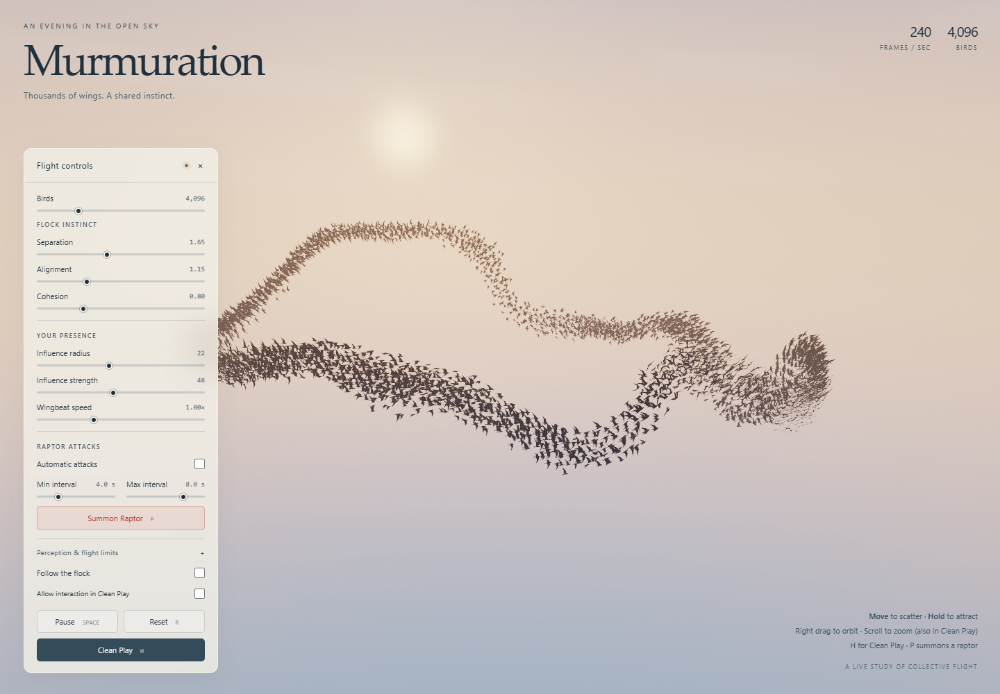

# 模拟鸟群 · Murmuration

A real-time 3D bird flock running entirely on the GPU with WebGPU — single HTML file, no libraries.

**在线体验 / Live demo:** https://zyjyzjzyj60.github.io/moni-niaoqun/

## Features
- 3D Boids (separation / alignment / cohesion) in WebGPU compute shaders, uniform-grid neighbor search (counting sort), up to 16384 birds
- Minimal silhouette birds with two-segment flapping wings, asymmetric downstroke, gliding, and banking
- Mouse acts as a predator (scatter); hold to attract
- Red raptor attacks every 2–10 s (adjustable), fear spreads through the flock
- Clean Play mode: hides all UI, fullscreen, cinematic auto camera

## Controls
| Key | Action |
| --- | --- |
| Space | Pause |
| R | Reset |
| F | Follow camera |
| H | Clean Play |
| P | Summon raptor |

Mouse: move to scatter, hold to attract, right-drag to orbit, scroll to zoom. Touch: tap to scatter, hold to attract, two fingers to orbit/zoom, double-tap for Clean Play.

## Run locally
Open `index.html` in a WebGPU-capable browser (recent Chrome or Edge). No build step.